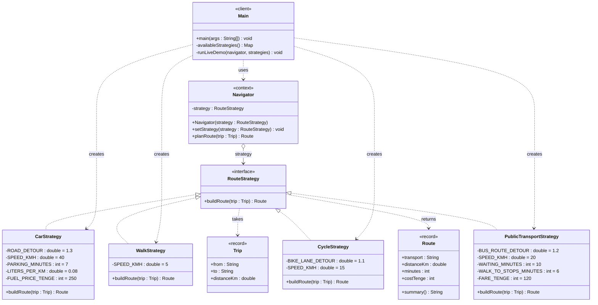

# Report: Assignment 5 - Strategy Pattern

**Navigator - Route Planning**

by Abraimov Yeskendir, SE-2502

## 1. Introduction

For this assignment I chose Option A - Navigation / Route Planning. I picked it because everyone uses a map
app, and every map app has the same buttons on top: car, walk, bike, bus. You press another button and the
same trip is planned in a different way. That is exactly a family of interchangeable algorithms.

The algorithm family is "how to get from A to B". The input is always the same - a `Trip` (from, to, distance
in km). The result is always the same shape - a `Route` (transport, real distance, minutes, cost in tenge). But
the way it is calculated is different for every transport:

- **Car** - roads are not straight, so the distance is ×1.3. Speed is 40 km/h in the city, plus 7 minutes to
  park. Cost is fuel: 0.08 l/km × 250 tg.
- **Walk** - a pedestrian can go almost straight through yards and parks. 5 km/h, free.
- **Bicycle** - bike lanes add a bit to the distance (×1.1), but 15 km/h is 3 times faster than walking. Free.
- **Public transport** - the bus route is ×1.2, 20 km/h, plus 6 minutes to walk to and from the stops and
  10 minutes of waiting. Fixed fare 120 tg.

Without the pattern all of this would sit in one `Navigator` method with a `switch` on the transport type.
With Strategy, every way of travel is its own class behind the `RouteStrategy` interface. `Navigator` only
holds a reference to this interface and calls `buildRoute()`. It doesn't know if it is a car or a bus. The
strategy can be changed at runtime with `setStrategy()` - in `Main` the same navigator plans one trip with
all 4 strategies, and in the live demo the user types `car`, `walk`, `cycle` or `bus` while the program is
running.

`PublicTransportStrategy` was added last, as a separate step. `Navigator` and the other three strategies
were not changed for it - that was the main thing I wanted to check.

## 2. UML Class Diagram

At the top is the client, in the middle is the context, at the bottom are the strategies. `Navigator` has only
one arrow down - to the interface. It has no arrow to any concrete strategy. Only `Main` knows the concrete
classes, because `Main` is the place where they are created.



*Figure 1 - Navigator delegates route planning to an interchangeable RouteStrategy*

| Role | Class |
|---|---|
| Strategy Interface | `RouteStrategy` - `buildRoute(Trip) : Route` |
| Concrete Strategies | `CarStrategy`, `WalkStrategy`, `CycleStrategy`, `PublicTransportStrategy` |
| Context | `Navigator` - holds a `RouteStrategy`, `setStrategy()` switches it at runtime |
| Client | `Main` - creates the strategies, chooses one, gives it to the navigator |
| Helpers | `Trip` (input of every strategy), `Route` (result of every strategy), `NavigatorTest` (tests) |

## 3. Clean Code Principles Applied

For this section I used chapters 9, 10 and 11 of *Clean Code*: Unit Tests, Classes and Systems. Chapter 10
fits Strategy almost directly - its main ideas (small classes, organizing for change, depending on abstractions)
are basically what the pattern is built on. Chapter 11 is about who creates the objects, and that is the part of
Strategy that is easy to get wrong. Chapter 9 is about tests, so I wrote tests for every strategy and for the
navigator.

### 1. Classes Should Be Small - Single Responsibility (Ch. 10)

Chapter 10 starts with: "The first rule of classes is that they should be small. The second rule of classes is
that they should be smaller than that." It measures size not in lines but in responsibilities, and the Single
Responsibility Principle says that a class should have one, and only one, reason to change.

In my project every strategy has one reason to change - its own algorithm. If buses get slower, only
`PublicTransportStrategy` changes. If fuel gets more expensive, only `CarStrategy` changes. `Navigator` has
one job too - hold a strategy and delegate to it. The book also says that you should be able to describe a
class in about 25 words without "if", "and", "or", "but". `CarStrategy`: "plans a route by car". `Navigator`:
"plans a route with the strategy it was given". Both work.

The names help with this too: `CarStrategy`, `WalkStrategy` - you know what the class does before opening
it. All numbers have names (`ROAD_DETOUR`, `PARKING_MINUTES`), so there are no magic numbers in the
formulas.

*Before - one class knows every transport:*

```java
public class Navigator {
    public Route planRoute(Trip trip, String mode) {
        // car formulas, walking formulas, bike formulas, bus formulas...
        // 4 reasons to change in one class
    }
}
```

*After - CarStrategy.java (the whole class):*

```java
public class CarStrategy implements RouteStrategy {
    private static final double ROAD_DETOUR = 1.3;
    private static final double SPEED_KMH = 40;
    private static final int PARKING_MINUTES = 7;
    private static final double LITERS_PER_KM = 0.08;
    private static final int FUEL_PRICE_TENGE = 250;

    @Override
    public Route buildRoute(Trip trip) {
        double distance = trip.distanceKm() * ROAD_DETOUR;
        int minutes = (int) Math.round(distance / SPEED_KMH * 60) + PARKING_MINUTES;
        int cost = (int) Math.round(distance * LITERS_PER_KM * FUEL_PRICE_TENGE);
        return new Route("Car", distance, minutes, cost);
    }
}
```

### 2. Organizing for Change - No Conditionals, Open for Extension (Ch. 10)

The book says: "In an ideal system, we incorporate new features by extending the system, not by making
modifications to existing code." In its `Sql` example a class with one method for every kind of statement is
split into a subclass per statement, and then adding a new statement doesn't touch the old ones. This is the
Open-Closed Principle.

With a `switch`, every new transport means opening `Navigator` again, adding a `case`, and maybe breaking a
case that already worked. With Strategy the `switch` is gone - the choice is made by polymorphism.
`Navigator.planRoute()` is one line and has no `if` and no `switch`. I checked it: the only `switch` word left in
`src/` is in comments.

I tested this on myself: `PublicTransportStrategy` was added as the last step. For it I wrote one new class, and in
`Main` one import plus one `strategies.put("bus", ...)` line. `Navigator`, `CarStrategy`, `WalkStrategy`,
`CycleStrategy` were not changed at all.

*Before - the conditional that Strategy removes:*

```java
public Route planRoute(Trip trip, String mode) {
    switch (mode) {
        case "car":   /* car formula */   break;
        case "walk":  /* walk formula */  break;
        case "cycle": /* cycle formula */ break;
        // a new transport = change this method again
        default: throw new IllegalArgumentException("Unknown mode " + mode);
    }
}
```

*After - Navigator.java:*

```java
public Route planRoute(Trip trip) {
    return strategy.buildRoute(trip);
}
```

*New strategy - PublicTransportStrategy.java, nothing else was edited:*

```java
//added last - Navigator and the other strategies were not changed for it
public class PublicTransportStrategy implements RouteStrategy {
    ...
    public Route buildRoute(Trip trip) {
        double distance = trip.distanceKm() * BUS_ROUTE_DETOUR;
        int rideMinutes = (int) Math.round(distance / SPEED_KMH * 60);
        int minutes = WALK_TO_STOPS_MINUTES + WAITING_MINUTES + rideMinutes;
        return new Route("Public transport", distance, minutes, FARE_TENGE);
    }
}
```

### 3. Isolating from Change - The Context Depends on an Abstraction (Ch. 10)

Chapter 10 says that our classes should depend on abstractions, not on concrete details - this is the
Dependency Inversion Principle. The book's example is a `Portfolio` that depends on a `StockExchange`
interface instead of a real exchange. Because of that the test can give it a `FixedStockExchangeStub` that
always returns the same price.

My `Navigator` is the same as that `Portfolio`. Its only field is `RouteStrategy`, and there is no import of any
concrete strategy in `Navigator.java`. So the context is algorithm-agnostic: it doesn't know the speeds, the
detours or the prices, and it doesn't need to. This is also what Head First Design Patterns calls "program to an
interface, not an implementation" and "favor composition over inheritance".

The best proof is in my tests. `RouteStrategy` has one method, so a strategy can even be a lambda. The test
gives the navigator a "Teleport" strategy that doesn't exist in `src/` at all - and the navigator works with it
without any change, the same way `Portfolio` works with the stub.

*Before - the context depends on concrete classes:*

```java
public class Navigator {
    private CarStrategy car;
    private WalkStrategy walk;
    private CycleStrategy cycle;
    ...
}
```

*After - Navigator.java:*

```java
public class Navigator {
    private RouteStrategy strategy;
    ...
    public void setStrategy(RouteStrategy strategy) {
        this.strategy = Objects.requireNonNull(strategy, "Route strategy must not be null");
    }
```

*NavigatorTest.java - a strategy written right inside the test:*

```java
Navigator navigator = new Navigator(trip -> new Route("Teleport", trip.distanceKm(), 0, 999));
Route route = navigator.planRoute(TEN_KM_TRIP);
assertRoute(route, 10.0, 0, 999);
```

### 4. Separate Constructing a System from Using It - Dependency Injection (Ch. 11)

Chapter 11 says that software systems should separate the startup process, when objects are constructed
and "wired" together, from the runtime logic that runs after startup. The simple way to do it is "Separation of
Main": all construction goes into `main` (or modules called by `main`), and the rest of the application just
assumes the objects are already built. The second way is Dependency Injection: an object should not create
its dependencies by itself, it should receive them from outside.

This matters a lot for Strategy. If `Navigator` did `new CarStrategy()` by itself, it would depend on a concrete
class again, and principle 3 would be broken. So in my project:

- `Main.availableStrategies()` is the only place where concrete strategies are created;
- `Navigator` gets its strategy through the constructor and `setStrategy()` (constructor and setter injection);
- the live demo chooses a strategy with `Map.get(choice)`, not with `if`/`switch` on the type. The only check is
  `strategy == null` for a word that is not in the map.

*Before - the context creates its own strategy:*

```java
public class Navigator {
    private RouteStrategy strategy;

    public Navigator() {
        this.strategy = new CarStrategy();   // hard-wired, Navigator depends on CarStrategy again
    }
}
```

*After - Main.java (construction), Navigator only uses what it gets:*

```java
//the only place that knows all concrete strategies - a new one is one more line here
private static Map<String, RouteStrategy> availableStrategies() {
    Map<String, RouteStrategy> strategies = new LinkedHashMap<>();
    strategies.put("car", new CarStrategy());
    strategies.put("walk", new WalkStrategy());
    strategies.put("cycle", new CycleStrategy());
    strategies.put("bus", new PublicTransportStrategy());
    return strategies;
}
...
Navigator navigator = new Navigator(strategies.get("car"));
for (RouteStrategy strategy : strategies.values()) {
    navigator.setStrategy(strategy);
    System.out.println(navigator.planRoute(trip).summary());
}
```

### 5. Clean Tests - F.I.R.S.T. and a Single Concept per Test (Ch. 9)

Chapter 9 says: "What makes a clean test? Three things. Readability, readability, and readability." It also
gives the F.I.R.S.T. rules and the advice to test a single concept per test. The tests should follow the
BUILD-OPERATE-CHECK pattern: build the data, do the operation, check the result.

The project has no JUnit, so I wrote `NavigatorTest` without a framework. It has its own small `check()`,
`assertRoute()` and `assertThrows()` helpers - the book calls this a domain-specific testing language, helpers
that make the tests easier to read. There are 8 tests, every one checks one concept:

- **Fast** - 8 tests run in well under a second, no files, no network.
- **Independent** - every test creates its own strategy or navigator, nothing is shared except a constant trip.
- **Repeatable** - no randomness, no current time, the same numbers every run.
- **Self-validating** - every test prints `PASS` or `FAIL`, and the program exits with code 1 if something
  failed. Nobody has to read numbers and compare them by eye.
- **Timely** - the book means tests written just before the production code. Mine were written alongside the
  strategies, not after - close to test-first, but not strictly.

*Before - a "test" that only prints, and you have to check the numbers yourself:*

```java
public static void main(String[] args) {
    Navigator n = new Navigator(new CarStrategy());
    System.out.println(n.planRoute(new Trip("A", "B", 10)));
    n.setStrategy(new WalkStrategy());
    System.out.println(n.planRoute(new Trip("A", "B", 10)));
    // ... is 27 minutes right? you have to calculate it by hand
}
```

*After - NavigatorTest.java, one concept, BUILD-OPERATE-CHECK:*

```java
private static void navigatorUsesSwitchedStrategy() {
    Navigator navigator = new Navigator(new CarStrategy());   // build

    navigator.setStrategy(new WalkStrategy());                // operate
    Route route = navigator.planRoute(TEN_KM_TRIP);

    check(route.transport().equals("Walk"), "expected Walk, got " + route.transport());   // check
}
```

*Output:*

```
PASS  car adds road detour, parking and fuel
PASS  walking is straight and free
PASS  cycling is faster than walking
PASS  public transport adds waiting and fare
PASS  navigator uses the strategy it was switched to
PASS  navigator works with any new strategy
PASS  navigator rejects null strategy
PASS  trip rejects non-positive distance

8 passed, 0 failed
```

## 4. Conclusion

**Flexibility gained.** The navigator can change how it plans a route while the program is running, and it
doesn't contain a single `if` about the transport. Every algorithm can be read, changed and tested alone. A
new transport is one new class, plus an import and one line in `Main`. I checked this with `PublicTransportStrategy`, and the
test with the lambda "Teleport" shows that `Navigator` accepts strategies it has never seen.

**Classes added.** Instead of one `Navigator` with a `switch` I now have the interface and 4 strategy classes -
5 types for the same 4 formulas. For only two modes that would never change, a simple `if` would be shorter
and easier to read, and Strategy would be over-engineering. Another cost is that the client must know which
strategies exist to choose one - in my project `Main` knows all of them. I think this is the right place for that
knowledge (chapter 11), but it is still knowledge that someone has to have. The trade-off is worth it here,
because a map app really does get new ways of travel (scooters, taxi), and every one of them would make the
`switch` bigger.

**Compared to Bridge.** The structure looks almost the same as my Bridge from Assignment 3: a class holds a
field of an interface type and calls it, and the field can be changed with a setter. The difference is the
intent. Bridge was planned from the start to split two hierarchies (brand × channel), so both sides can grow
independently. Strategy has only one hierarchy - a family of algorithms for one task - and its goal is to
replace a conditional and let the client pick the algorithm at runtime.

## 5. GitHub Repository

Repository: https://github.com/Naitskaut/SDP

Assignment 5 folder: https://github.com/Naitskaut/SDP/tree/main/Assignment%205
